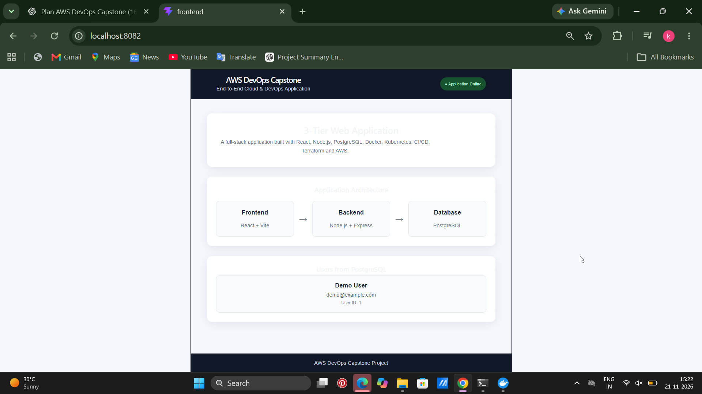
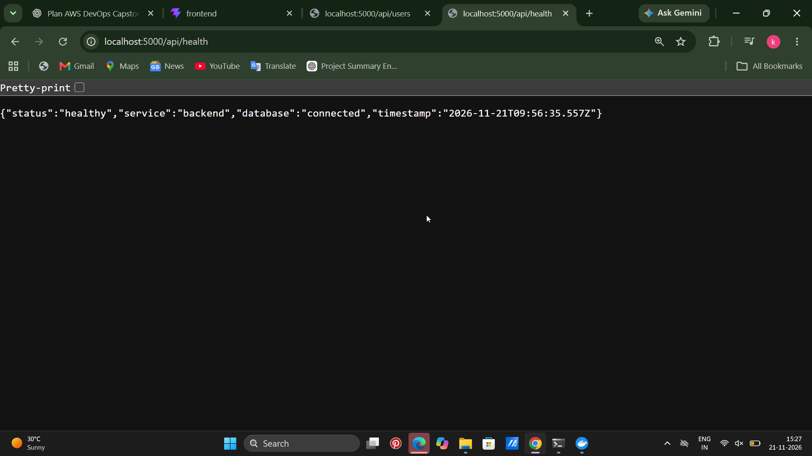
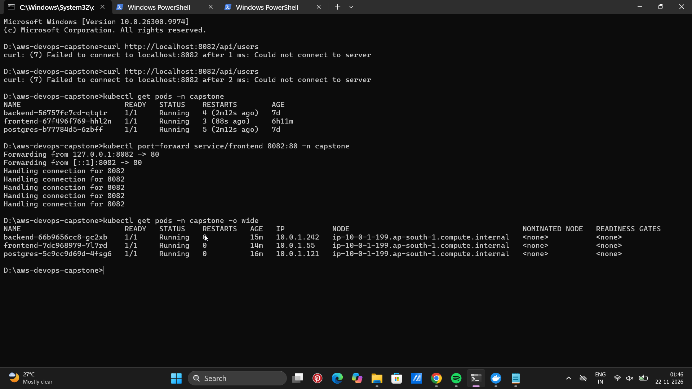
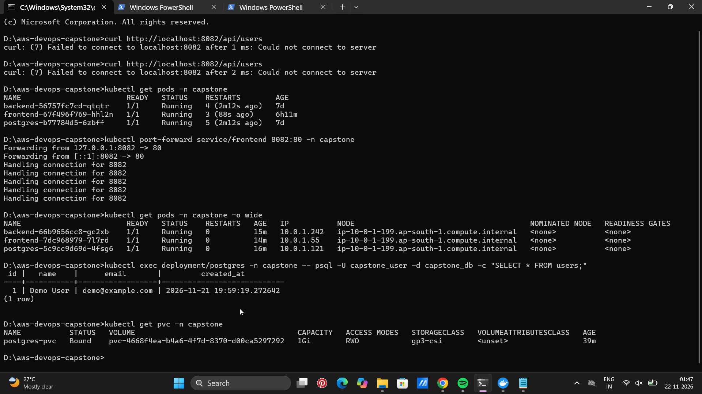
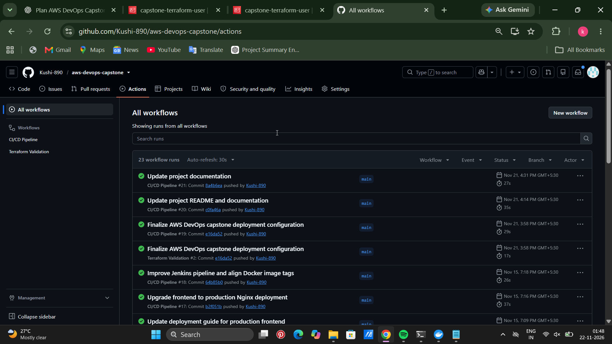

# AWS DevOps Capstone Project

# 1. Project Overview

This project demonstrates an end-to-end DevOps workflow by building, containerizing, testing, and deploying a three-tier web application.

The application consists of:
- React frontend
- Node.js and Express backend
- PostgreSQL database

The project uses Docker, Kubernetes, GitHub Actions, and Terraform to demonstrate modern DevOps practices.

# 2. Technologies Used

| Category | Technology |
|---|---|
| Frontend | React, Vite |
| Backend | Node.js, Express |
| Database | PostgreSQL |
| Containerization | Docker, Docker Compose |
| Orchestration | Kubernetes, Kind |
| CI/CD | GitHub Actions |
| CI/CD Automation | Jenkins |
| Infrastructure as Code | Terraform |
| Cloud Platform | AWS (VPC, EKS, ECR, IAM) |
| Version Control | Git, GitHub |

## 3. Project Architecture

The application follows a three-tier architecture:

1. Frontend – Provides the user interface.
2. Backend – Handles API requests and application logic.
3. Database – Stores application data using PostgreSQL.

Docker containers package the application components. Kubernetes manages local deployments using Kind. GitHub Actions automates testing and Terraform validation, while Jenkins automates Docker image builds and CI/CD workflows.
## 4. Project Structure

```text
aws-devops-capstone/
├── backend/
├── frontend/
├── database/
├── docker/
├── docs/
├── kubernetes/
├── scripts/
├── terraform/
├── tests/
└── .github/
    └── workflows/
```

## 5. Key Implementations

- Developed REST API endpoints.
- Integrated the backend with PostgreSQL.
- Containerized application components using Docker.
- Configured Kubernetes Deployments and Services.
- Implemented ConfigMaps, Secrets, persistent storage, and health probes.
- Configured GitHub Actions workflows.
- Added automated backend API tests.
- Created Terraform configuration for AWS networking.
- Implemented Jenkins CI/CD pipeline for building Docker images.
- Published container images to Amazon Elastic Container Registry (ECR).
- Created Terraform configurations for Amazon EKS and managed node groups.
- Configured multi-Availability Zone AWS networking with public and private subnets.

## 6. Testing and Validation

- Backend API tests executed successfully.
- Frontend and backend integration verified locally.
- PostgreSQL connectivity verified.
- Kubernetes application tested using Kind.
- Terraform formatting and validation checks passed.
- GitHub Actions workflows executed successfully.

## 7. AWS Infrastructure

AWS infrastructure was provisioned using Terraform and deployed on Amazon Web Services.

Infrastructure components include:

- AWS Virtual Private Cloud (VPC)
- Public and private subnets across two Availability Zones
- Internet Gateway and route tables
- Amazon EKS cluster
- Managed EKS worker node group
- IAM roles and policies
- Amazon ECR repositories
- Amazon EBS persistent storage using the EBS CSI driver

The application was successfully deployed on Amazon EKS using Kubernetes.

The PostgreSQL database uses persistent EBS storage. Kubernetes Secrets manage database credentials, while ConfigMaps provide application configuration.

The frontend, backend, and PostgreSQL services were verified successfully within the EKS cluster.

The application was independently deployed and verified end-to-end on a local Kind Kubernetes cluster.

## 8. Security Practices

- Backend container runs as a non-root user.
- Database credentials are managed using Kubernetes Secrets.
- Sensitive files and Terraform state are excluded from Git.
- Database is not intended to be exposed publicly.

## 9. Project Status

- [x] Application development
- [x] Docker containerization
- [x] Local Kubernetes deployment using Kind
- [x] Backend API testing
- [x] GitHub Actions CI/CD workflow
- [x] Jenkins CI/CD pipeline
- [x] Amazon ECR image publishing
- [x] Terraform AWS infrastructure provisioning
- [x] Amazon EKS cluster and managed node group
- [x] Kubernetes frontend and backend deployment on EKS
- [x] PostgreSQL deployment with EBS persistent storage
- [x] Kubernetes ConfigMaps and Secrets
- [x] Backend health and database connectivity verification
- [x] End-to-end AWS EKS application testing
- [x] Project documentation

## 10. Application Screenshots

### Frontend Application


### Backend API Response


### Backend Health Check

### Kubernetes Pods


### PostgreSQL Database


### GitHub Actions Pipeline


## 11. Author
**Kushi Jeej**

AWS and DevOps Capstone Project
